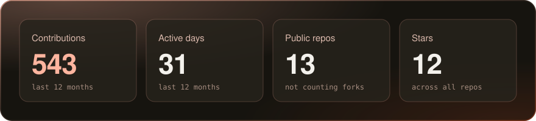
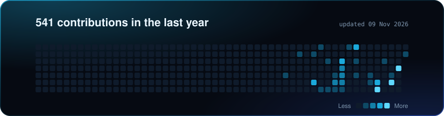

Most of what I build starts at a hackathon and keeps going after it. I care about the part after the demo: measuring whether the thing works, writing down where it doesn't, and fixing it.

[LinkedIn](https://www.linkedin.com/in/soham-ghosh-249615293/)

## Recent work

**[Zen](https://github.com/ShadowIzzHerZ/ZenMazon)** · Python, FastAPI\
An AI agent for multi-step admin tasks (expenses, travel, payments) behind a deterministic policy engine and human approval for risky actions. On a 30-case test set with prompt-injection attacks, the policy layer took violations from 47% to 0% and task success from 43% to 90%.

**[SIH26168 dead reckoning](https://github.com/ShadowIzzHerZ/SIH-2k2026)** · PyTorch, Kotlin\
Keeps vehicle position tracking alive through GPS blackouts using phone IMU data and a CNN+GRU bias-correction model. 3.4% median drift over 5 s on unseen highway segments, with the weaker results on harder data written up next to it.

**[Zotify](https://github.com/ShadowIzzHerZ/Zotify)** · FastAPI, Postgres\
Music discovery you steer with a sentence. Semantic IDs from residual k-means over 30,000 tracks, trie-constrained search so only real tracks come back, and a slider between familiar and outside your routine.

**[SkyReady](https://github.com/ShadowIzzHerZ/SkyReady)** · JavaScript, Python, OR-Tools\
Predictive maintenance for an aircraft fleet (SIH26249). Remaining-useful-life ranges feed a CP-SAT scheduler that plans repairs, hangar slots and spares for fleet availability.

**[Fraud analysis](https://github.com/ShadowIzzHerZ/Fraud-Analysis-Using-AI-ML)** · Python, NiceGUI, Kotlin\
Scores a live transaction stream with an explainable rules and statistics engine, with an analyst console to triage what fires.

Smaller and older projects

- [Civic issue reporter](https://github.com/ShadowIzzHerZ/A-civic-issue-reporter): photo and GPS reports on a shared map, on-device image tagging, works offline
- [Peer tutoring marketplace](https://github.com/ShadowIzzHerZ/The-Peer-Tutoring-Marketplace): students trade skills, Supabase with row level security ([live](https://main.d1lbffpnvsb54h.amplifyapp.com/))
- [F1 telemetry](https://github.com/ShadowIzzHerZ/F1-Telemetry): speed trace of a qualifying lap with fastf1
- [Random projects](https://github.com/ShadowIzzHerZ/Random-Projects): LeetCode solutions in Java

## Activity

